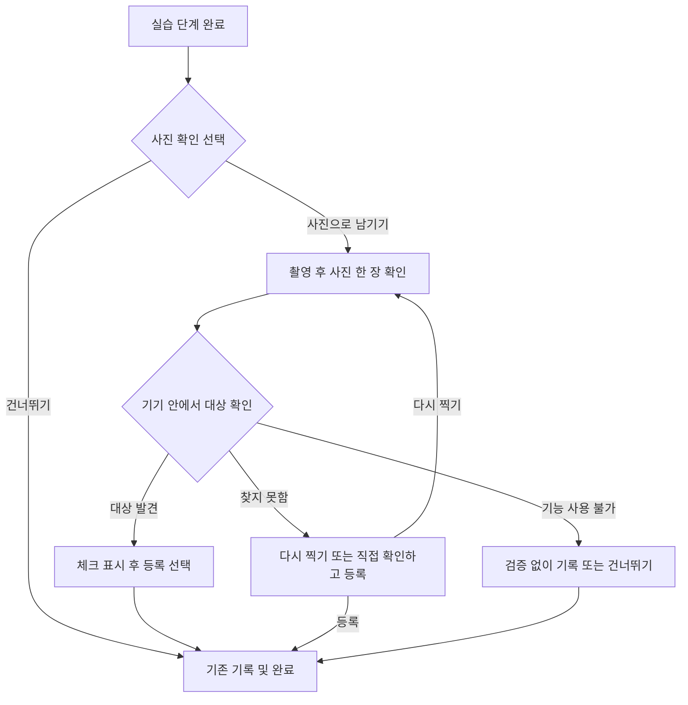

# 카메라 미션 검증 계획

사진 검증을 선택 기능으로 제공해 실제 활동에 참여할 계기를 만들고, 참여에 영양제를 추가 지급한다. 첫 버전은 사진 한 장에서 미션과 관련된 물체가 보이는지 기기 안에서 확인한다. 사진은 물체의 존재를 뒷받침하지만, 물을 마셨는지·글을 읽었는지·감각에 주의를 기울였는지까지 증명하지는 못한다.

2026-11-04 기준 계획이며 기능 구현은 아직 시작하지 않았다. 작업 브랜치는 `codex/camera-mission-validation`, 기준은 최신 `origin/main`의 `b7332ee`다. 식물 개선 작업은 `codex/procedural-plant-generation`의 `644fec0`에 보존한다.

## 확정한 방향과 현재 앱

사용자가 확정한 방향은 선택적 검증, 대상 발견 시 체크 표시, 미확인 시에도 등록 선택 제공, 기존 완료 보상 유지, 추가 보상을 통한 긍정적 경험이다. 일반 미션 보상이 영양제라면 추가 보상도 같은 재화를 사용한다.

현재 앱을 확인한 결과는 다음과 같다.

| 항목 | 현재 동작과 계획에 주는 영향 |
| --- | --- |
| 일반 보상 | `DemoBalanceConfig.CompletionNutrient = 5`. 현재 기본 미션의 보상 가능한 회차, 자유 미션의 해당 일자 첫 보상은 영양제 5개다. 복습·동일 보상 대상 재완료는 추가 지급하지 않는다. |
| 완료 처리 | `GardenStateService.CompleteFocusSession`이 완료·진도·영양제·중복 방지 영수증을 한 번의 상태 저장으로 반영한다. 사진 추가 보상도 이 경로에 결합한다. |
| 사진 기능 | 사용자 사진 촬영·보관·검증 기능과 관련 모델은 아직 없다. 촬영부터 새로 연결해야 한다. 정원 렌더링용 Camera와는 별개다. |
| 현재 화면 | `ShowHome/ShowCourse`는 Focus 화면으로 연결된다. 현행 카탈로그는 기본 P01~P28, 자유 M01~M17이다. 2·4·8주 코스가 P 활동을 배열·반복한다. |
| 참고 기획서 | 연결된 MBCT 문서는 별도 48회 소재 중심 목록이다. `MbctContent`와 구 기록 해석에 쓰이는 목록이며 현재 P 코스 순서와 같지 않다. 주차 번호로 현재 미션을 추측해서 연결하지 않는다. |
| Android 기반 | Unity의 기존 Kotlin 플랫폼 모듈을 사용할 수 있다. 현재 모듈은 minSdk 29, compileSdk/targetSdk 36이다. |

기준 코드: [보상과 저장](../Assets/Scripts/Runtime/LocalGardenState.cs), [현행 카탈로그](../Assets/Scripts/Runtime/FocusMissionCatalog.cs), [현재 화면 진입](../Assets/Scripts/Runtime/WeekOneQuestDemo.FocusHome.cs), [완료 화면](../Assets/Scripts/Runtime/WeekOneQuestDemo.FocusPractice.cs), [구 MBCT 목록](../Assets/Scripts/Runtime/MbctContent.cs), [Android 모듈](../Assets/Plugins/Android/CapstonePlatform.androidlib/build.gradle).

## 검증 가능한 미션 분류

확인 대상은 모델의 지원 라벨과 미션의 실제 선택 내용이 모두 맞는 경우에만 활성화한다. 물체가 탐지됐다는 사실과 활동 완료 여부는 각각 표시한다. 미지원 소재를 고른 사용자에게 미탐지 안내를 반복하지 않는다.

### 현행 미션

| 미션 | 사진에서 확인할 수 있는 것 | 자동 확인의 한계 | 적용 순서 |
| --- | --- | --- | --- |
| M03 물 마시기, P04 한 모금 천천히 | 컵·병 등 음료 용기 | 물의 유무·종류, 실제 섭취·온도·마음챙김은 판단 불가 | 1차 적용 후보 |
| M14 짧은 글 읽기 | 종이책 | 읽었는지 판단 불가. 휴대폰·웹 글을 선택한 경우 책을 요구하지 않음 | 종이책을 선택한 경로에 1차 적용 후보 |
| M12 주변 식물 살피기 | 화분에 심은 식물 | 모델의 `potted plant`는 모든 나무·풀·꽃을 포괄하지 않음 | 화분 대상으로 별도 성능 확인 후 확대 |
| P17 나를 돕는 작은 행동 | `activity=물 마시기`인 경우 용기 | 쉬기·창밖 보기 경로에 용기 검증을 적용하지 않음 | 1차 용기 기능 안정화 후 재사용 |
| P23 한입에 주의 기울이기 | 지원되는 특정 식재료, 또는 그릇이라는 보조 대상 | 김치·밥알·과자·모든 음식을 일괄 인식할 수 없음. 빈 그릇도 식사 증거가 아님 | 2차 연구 후보, 1차 자동 검증 제외 |
| M06 물건 정리, P06 일상 행동, M16 공원 방문 | 일부 생활 물체·싱크대·벤치 | 정리 전후 변화·손 씻기·공원 방문을 한 장으로 확인할 수 없음 | 자동 검증 제외. 사진 기능 확대 시 기록 용도로만 검토 |
| 그 밖의 미션 | 감정·호흡·소리·생각·자세의 편안함 등 | 물체 탐지로 수행의 질이나 내적 경험을 확인할 수 없음 | 현재 사용자 확인 방식 유지 |

마지막 두 행의 제외 범위는 M01·M02·M04~M11·M13·M15~M17 및 P01~P03·P05~P16·P18~P22·P24~P28이다. 사진에 사람이 있거나 의자가 보인다는 이유로 움직임·호흡·자세 수행을 인증하지 않는다. 얼굴의 감정 추정과 몸·방 내부 촬영 요구도 도입하지 않는다.

1차 구현 범위는 **M03·P04의 용기 확인, M14의 종이책 확인**으로 제안한다. 책 이외의 글을 읽거나 사진을 원하지 않는 사용자는 현재 경로로 완료한다. M12는 일반 식물 탐지가 충분하다고 가정하지 않고 별도 평가 후 활성화한다.

### 연결된 주차별 MBCT 기획서

아래는 기획서의 회차를 분류한 것으로, 현재 P 미션의 회차 번호가 아니다. 기획 문서는 `CapstoneDesign2026-Docs`의 `3f80bfb`에서 확인했다.

| 주차와 구 회차 | 기획 활동 | 사진 확인 후보와 적용 범위 |
| --- | --- | --- |
| 1주 1회 `MBCT01` | 물 한 모금 | 음료 용기는 지원 가능. 대체 음식을 선택했다면 그 선택에 맞게 다시 판단 |
| 2주 7회 `MBCT07` | 과자 한 입 | 과자 전반을 기본 모델의 지원 범주로 간주하지 않음 |
| 3주 13회 `MBCT13` | 김치 한 입 | 김치 전용 라벨이 없어 자동 확인 제외 |
| 4주 19회 `MBCT19` | 밥알 한 입 | 밥알 전용 라벨이 없고 작은 대상이므로 자동 확인 제외 |
| 7주 39회 `MBCT39` | 평소 식사 한 입 | 선택한 음식이 모델 지원 범주에 해당할 때만 후속 검토 |
| 1주 4회, 2주 8·12회, 3주 18회, 8주 45회 | 익숙한 행동 | 물 마시기·양치 등 선택한 행동과 대상에 따라 후보가 달라짐. 자유 입력은 자동 규칙으로 해석하지 않음 |
| 나머지 38회 | 몸·호흡·움직임·생각·소리·돌봄·계획 | 정지 사진으로 실습 수행을 확인하지 않음 |

현재 앱에는 `(FocusVersion, MissionId, 선택한 경로)`로 정책을 연결한다. 구 MBCT 기록과 단축 코스는 원래 ID·`sourceId` 의미를 유지한다. 과거 세션을 소급해서 사진 필수 미션으로 바꾸지 않는다.

## 사용자 흐름

검증 가능한 미션의 실습 단계를 마친 뒤, 감정 기록·최종 완료 전에 선택적인 사진 영역을 제공한다. 감정 기록과 사진은 각각 건너뛸 수 있다. 진행 중 사진 때문에 실습 화면의 기존 단계 번호가 바뀌지 않게 한다.

| 상태 | 사용자에게 보여줄 안내 | 처리 |
| --- | --- | --- |
| 발견 | `✓ 컵을 찾았어요` | 사용자가 사진을 확인하고 등록. 미션 완료 인증이라는 문구는 쓰지 않음 |
| 미확인 | `사진에서 컵을 찾지 못했어요. 이대로 등록할까요?` | `다시 찍기` / `직접 확인하고 등록`. 자동 인식과 직접 확인은 기록에서 구분 |
| 사진 품질 부족 | `조금 더 밝거나 가까이 찍으면 확인에 도움이 돼요.` | 재촬영 권유는 한 번만 하고 등록·건너뛰기 제공 |
| 오류·시간 초과·미지원 | `지금은 사진을 자동으로 확인하기 어려워요.` | 실패로 표시하지 않고 기본 완료 유지. 미지원 소재는 처음부터 자동 확인 안내 생략 |

사진 선택은 한 세션에 한 번만 제안하며 강제 모달·실패 횟수·연속 성공·재촬영 벌점은 두지 않는다. 모델이 찾은 임의 라벨 목록, 신뢰도 수치, 기술 오류 코드는 일반 화면에 표시하지 않는다. 사용자가 확인할 사진 미리보기와 해당 미션 대상만 표시한다.

## 영양제 보상

**확정:** 일반 완료 보상은 현재의 영양제 5개를 유지하고, 선택 검증의 추가 보상도 영양제로 지급한다. 검증 생략·미확인·장치 오류가 기본 완료와 보상을 차단하지 않는다.

**초기 구현 기본값:** 계획안대로 구현하라는 후속 요청에 따라 영양제 1개, 하루 1회를 적용하고 수량·상한은 별도 설정으로 둔다. 자동 확인 또는 사진을 보고 직접 확인한 경우에 같은 추가 영양제를 준다. `자동 확인됨`과 `직접 확인함` 상태는 합치지 않는다. 아무 확인 없이 사진만 저장하거나 촬영을 취소한 경우는 추가 보상 대상에서 제외한다. 하루의 경계는 기존 미션 날짜 설정(기본 오전 4시)을 따른다.

| 선택과 결과 | 기본 보상 | 추가 보상 기본값 |
| --- | --- | --- |
| 사진 없이 정상 완료 | 5개 | 없음 |
| 자동 확인 후 사진 등록과 정상 완료 | 5개 | 1개, 일일 상한 내 |
| 미확인 후 직접 확인·등록과 정상 완료 | 5개 | 동일 1개, 일일 상한 내 |
| 검증 중 오류 | 5개 유지 | 사진이 있고 직접 확인·등록하면 동일 1개, 상한 내 |
| 재촬영·재시도·중복 콜백 | 기존 지급만 유지 | 중복 지급 없음 |
| 복습·보상받은 동일 회차 재완료 | 추가 기본 보상 없음 | 추가 보상 없음 |

실제 지급은 사진 확인 버튼에서 즉시 처리하지 않고 **활동 완료가 저장될 때** 반영한다. 추가 보상 가능 여부는 촬영 전에 안내하고, 한도가 소진됐거나 복습 중이면 추가 보상을 약속하는 문구를 표시하지 않는다. 추가 보상 키는 기존 기본 보상 영수증에 결합해 `photo-v1|기본보상키`로 만든다. 기본 보상액과 사진 보상액은 별도로 저장·표시하고, 앱 재시작·날짜 경계·코스 변경·사진 교체로 같은 대상의 보상이 다시 생기지 않게 한다. 사진을 나중에 삭제해도 이미 지급한 보상을 회수하지 않고 영수증은 유지한다.

## 로컬 모델과 촬영 방식

기본 제안은 **Android Kotlin에서 MediaPipe Tasks Object Detector와 EfficientDet-Lite0 int8을 실행**하고, Unity는 사진 미리보기·결과·완료 흐름을 맡는 구조다. 모델을 앱에 포함해 설치 후 비행기 모드에서도 동작하도록 한다. 첫 버전은 촬영 후 정지 사진 1회 추론이며 실시간 카메라 탐지는 후속 범위다.

EfficientDet-Lite0은 320×320 입력의 COCO 계열 탐지 모델이다. 공식 라벨에는 `cup`, `bottle`, `book`, `potted plant`가 있고 김치·밥알·물·일반적인 공원은 없다. 라벨 파일에는 빈 항목도 있으므로 숫자 인덱스를 임의로 붙이지 않고 배포 모델의 메타데이터를 검증한다. 이 범위가 위 미션 분류의 근거다. [공식 모델 안내](https://developers.google.com/edge/mediapipe/solutions/vision/object_detector), [공식 라벨 목록](https://storage.googleapis.com/mediapipe-tasks/object_detector/labelmap.txt)

MediaPipe는 Android SDK 24 이상을 지원하므로 현재 minSdk 29와 기본 조건이 맞는다. `tasks-vision`과 모델 assets를 기존 Android 모듈에 추가하되 실제 패키징 호환은 APK로 확인한다. 라이브러리 버전·모델 버전·SHA-256·라이선스를 고정하고 `latest.release`를 빌드에 남기지 않는다. CPU를 먼저 측정하고 GPU는 별도 비교한다. [Android 설치 조건](https://developers.google.com/edge/mediapipe/solutions/setup_android), [탐지기 연결 방법](https://developers.google.com/edge/mediapipe/solutions/vision/object_detector/android)

| 후보 | 역할 | 선택 조건 |
| --- | --- | --- |
| EfficientDet-Lite0 int8 | 첫 기준 모델 | 컵·책의 정확도와 대상 기기 지연 기준을 함께 만족하면 채택 |
| SSD MobileNetV2 | 더 가벼운 비교 후보 | Lite0 지연이 목표를 벗어날 때 같은 데이터로 비교 |
| 전용 추가 학습 모델 | 식물·한국 음식 확대 후보 | 기본 모델의 미지원 범주가 실제로 필요한 경우 데이터 수집·권리 확인·별도 평가 후 진행 |

정지 사진은 Android의 시스템 카메라에 위임하는 `TakePicture` 계약과 제한된 `FileProvider` URI를 우선 검토한다. 원본 파일을 반환받고 EXIF 회전·미러링을 정규화한 뒤 추론 크기로 축소한다. 시스템 카메라가 없거나 촬영이 취소되면 선택 화면으로 돌아온다. 첫 구현에서는 갤러리 가져오기와 외부 공유를 제외한다. [Android 사진 촬영 계약](https://developer.android.com/reference/androidx/activity/result/contract/ActivityResultContracts.TakePicture)

검증 점수는 실제 활동 수행 확률로 표현하지 않는다. 미션별 허용 라벨과 검증용 데이터로 임계값을 정하고, 기준 미만은 `대상 없음` 단정 대신 `미확인`으로 처리한다. 음식 모델이 없다는 이유로 사용자의 식사 소재를 바꾸도록 유도하지 않는다.

## 구현 단위와 저장 설계

| 위치 | 구현할 책임 |
| --- | --- |
| 신규 `CameraMissionPolicy.cs` | 대상 미션·선택 경로·지원 라벨·문구·보상 정책을 담는 순수 C# 규칙 |
| 신규 `PhotoVerificationService.cs` | 촬영/검증 공급자 인터페이스, 요청 ID, 시간 초과, Editor용 합성 응답 |
| 신규 `WeekOneQuestDemo.PhotoEvidence.cs` | 선택 촬영·미리보기·체크·미확인 안내·복귀 화면 |
| `WeekOneQuestDemo.FocusPractice.cs` | 기존 마지막 실습 단계와 감정/최종 완료 사이에 선택 흐름 연결 |
| Android의 신규 촬영 Activity·탐지기 | 촬영 URI 수명, 작은 Bitmap 디코딩, 단일 작업자에서 추론, 리소스 해제 |
| `AndroidPlatformBridge.cs/.kt` | 사진 요청과 결과 전달. 센서 수집 루프와 분리 |
| `LocalGardenState.cs` | 선택 사진 메타데이터, 저장·검증·복사, 추가 보상 영수증, 삭제와 이관 |
| 기존 기록 화면 | 해당 활동의 사진과 자동/직접 확인 상태 표시, 사진만 삭제 |

사진 메타데이터에는 `EvidenceId`, `SessionId`, 상대 파일 식별자, 촬영 시각, `TargetSnapshot`, `PolicyVersion`, `ModelVersion`, 확인 상태, 사용자 결정, 별도 추가 보상액을 둔다. 감정 본문이나 사진 바이트를 브리지 JSON·상태 XML·분석 로그에 넣지 않는다. 사진 ID는 파일 경로로 직접 신뢰하지 않고 앱 전용 디렉터리 안의 식별자로 검증한다.

현재 main의 schema 1에 선택 필드를 추가하는 호환 방식을 우선 검토한다. 구 저장본의 기본값은 `사진 없음`이며 `Copy/Decode/Validate`를 함께 갱신한다. 구 Focus 세션의 단계 인덱스와 프롬프트를 보존한다. 식물 브랜치의 schema 변경을 이번 계획 때문에 함께 도입하지 않으며, 추후 통합 시 이관 충돌을 별도로 검증한다.

사진 파일과 상태 파일은 한 번에 원자적으로 쓸 수 없으므로 순서를 명시한다. 임시 사진 → 정규화된 앱 전용 파일 → 해당 파일을 참조하는 상태와 완료·보상 저장 → UI 성공 표시로 처리한다. 저장 실패 시 재시도할 자료를 유지하고 기본 완료·보상의 부분 반영을 막는다. 강제 종료 후에는 상태에서 참조하지 않는 임시 파일만 정리한다. 참조 중 사진이 사라져도 완료·진도·보상은 유효하게 남긴다.

검증 결과는 `SessionId + EvidenceId + 요청 세대`와 결합한다. 재촬영·뒤로 가기·코스 변경 후 도착한 이전 결과를 무시한다. 촬영 중 앱 종료, 중복 네이티브 콜백, 취소 뒤 완료 콜백도 같은 규칙으로 처리한다. 추론은 UI 스레드를 막지 않고 동시에 한 건만 실행한다.

사진은 앱 내부 기록에만 저장하고 서버로 전송하지 않는다. 미리보기·기록용 축소본은 긴 변 1,280px, 파일당 1MB 이내를 초기 목표로 잡는다. 재인코딩으로 위치 등 EXIF를 제거하고 촬영 원본은 선택 취소·등록 이후 정리한다. 자동 백업 제외, 촬영용 URI 권한 회수, 기록 삭제·전체 초기화 시 관련 사진 삭제를 포함한다. 기록에 붙인 사진은 사용자가 지울 때까지 보존하는 안이며 촬영 안내에서 이를 설명한다.

## 단계별 진행과 완료 기준

| 단계 | 작업 | 다음 단계로 넘어갈 기준 |
| --- | --- | --- |
| 1. 범위와 표본 | 용기·종이책 정책, 선택/미확인 UX, 보상 조건 확정. 합성 UI 자료와 허가된 실제 사진 평가셋 준비 | 각 대상의 지원/미지원 경계와 정답 기준이 명시됨 |
| 2. 기기 실험 | Android 단독 정지 사진 추론, Lite0 기준 측정. 필요하면 MobileNet 비교 | 오프라인 실행, 대상별 정확도, 지연·메모리·APK 증가량 확인 |
| 3. 촬영과 화면 | 촬영·취소·복귀·정규화·미리보기·체크·직접 등록. 먼저 보상 없이 합성 응답으로 흐름 연결 | 성공/미확인/오류/건너뛰기를 모두 끝까지 완료 가능 |
| 4. 상태와 보상 | 파일 수명·기록·영수증·중복 방지·저장 실패 처리와 영양제 표시 | 기존 저장본 보존, 정확히 한 번 지급, 오류에도 기본 완료 보존 |
| 5. 통합 검증 | 실제 촬영과 로컬 모델 연결, 최종 APK와 실기기 UX 확인 | 아래 통과 기준 충족 후 M03·P04·종이책 M14 활성화 |
| 후속 | 화분 M12, 조건부 P17, 음식 전용 모델, 필요 시 실시간 확인 | 대상별 평가를 통과한 범위만 순차 확대 |

### 모델과 기기 평가

용기·책 각각 긍정 100장, 부정 및 혼동 사례 100장을 최소 파일럿 목표로 잡는다. 밝기·반사·투명 용기·가림·거리·회전·세로/가로·인쇄된 물체 사진 등을 포함한다. 같은 물체와 촬영 세션의 유사 컷이 임계값 조정용과 최종 평가용에 나뉘어 섞이지 않게 한다. 최소 40%는 임계값을 고정한 뒤 한 번 평가할 용도로 남긴다. 작은 표본의 한계와 신뢰구간을 함께 보고한다.

초기 통과 목표는 대상별 정밀도 95% 이상, 재현율 85% 이상이다. 전체 평균만으로 취약 대상을 숨기지 않고 혼동·미지원 소재와 일반 촬영을 나누어 보고한다. 미달 대상은 자동 확인 기능을 끄고 사진 기록과 직접 확인만 유지하는 선택지를 둔다. 사진 속 컵 사진/스크린을 완전히 구별하거나 실제 활동을 증명하는 지표로 확대하지 않는다.

Galaxy Tab A7 등 기존 대상 기기에서 초기 로딩과 재사용을 구분해 측정한다. 사진 수신 후 결과 표시의 p95 1.5초 이내, 5초 후 대체 경로 제공, 기능 활성화에 따른 메모리 증가 128MB 이내, APK 증가 30MB 이내를 초기 설계 목표로 둔다. 이는 아직 측정한 결과가 아니다. 비행기 모드, 카메라 앱 전환·복귀, 20회 반복 촬영 시 누수와 발열·실패율도 확인한다.

### 앱 회귀 검증

- 보상 가능한 일반 완료 5개, 사진 생략·미확인·오류 후 동일 기본 보상, 복습·중복 완료 무보상.
- 추가 보상은 한 번만 지급. 촬영 취소·재촬영·콜백 중복·저장 실패·강제 종료·새벽 일일 경계·코스 변경에서 재검증.
- 기존 저장본의 정원·기록·코스·영양제 보존. 사진만 삭제해도 활동과 보상 유지. 초기화 후 미참조 사진 정리.
- 잘못된 경로·손상된 사진·과대 이미지·회전 정보·미지원 모델·모델 버전 불일치 처리.
- 실제 Unity 버튼과 Android 카메라 반환 경로를 함께 확인. 네이티브 릴리스 빌드의 의존성·ABI·라이브러리 패키징 검증.
- 모델 평가용 사진은 공개 라이선스/허가 자료를 쓰고 개인 사진·원본 캡처·기기 식별자는 저장소에 게시하지 않음. 실기기 작업은 기존 `AGENTS.md`의 백업·화면 설정 복구 규칙을 따름.

## 구현 기본값과 후속 결정

사용자의 계획안 구현 요청에 따라 **추가 1개·하루 1회·자동 또는 직접 확인에 동일 지급**을 초기 기본값으로 적용한다. `DemoBalanceConfig.PhotoVerificationNutrient`와 `PhotoVerificationDailyLimit`에서 바꿀 수 있다. 기존 완료 보상 5개는 그대로이며, 최종 완료 저장과 동시에 추가 보상을 지급한다. 복습·동일 보상 회차·일일 한도 초과는 추가 지급하지 않는다. 사진 삭제 또는 미션 기록 초기화 뒤에도 사진 보상 영수증은 남겨 중복 지급을 막는다.

### 2026-11-04 로컬 구현 범위

- M03·P04의 `cup`/`bottle`, M14의 `book`만 대상으로 연결했다. M14는 종이책 촬영과 다른 읽기 소재 건너뛰기를 명시한다. 이전 Focus v1 기록과 다른 미션은 자동으로 대상에 편입하지 않는다.
- 마지막 실습 뒤 선택 사진 화면을 삽입한다. 단계 번호는 유지하며 감정 기록과 사진을 각각 건너뛸 수 있다. 발견·미확인·촬영 취소·오류에서 재촬영, 직접 확인, 건너뛰기를 제공한다.
- Android 시스템 카메라와 제한된 캐시 FileProvider를 사용한다. MediaPipe Tasks Vision 0.10.35와 EfficientDet-Lite0 int8 v1을 앱에 포함한다. 대상 라벨은 모델에 내장된 `labels.txt`에서 확인했다. 다운로드·SHA-256·라이선스는 Android assets의 `models/camera-model.json`과 동봉 라이선스에 기록한다. `python scripts/check-camera-model.py`로 검증하며 `--download`는 고정된 공개 파일만 복구한다.
- 사진 원본은 회전·미러링 정규화 후 긴 변 1,280px 이하, JPEG 1MB 이하로 재인코딩한다. EXIF를 복사하지 않으며 앱 내부 `noBackupFilesDir/mission_photos`에 보관한다. 감정·사진 바이트를 브리지 JSON이나 로그에 넣지 않는다.
- 요청 ID와 세션의 저장된 대기 ID를 비교해 이전 촬영 응답을 무시한다. 처리 5초 뒤에는 직접 확인 또는 건너뛰기 경로를 제공한다. 완료 저장 실패는 보상·기록 모두 유지하고 재시도한다. 사진 파일 유실은 활동 기록과 보상을 무효화하지 않는다.
- 활동 기록에 사진, 자동/직접 확인 구분, 별도 보상액과 사진만 삭제 버튼을 추가한다. 삭제·기록 초기화는 상태 저장 성공 후 파일을 정리한다. 참조 없는 임시 파일은 24시간 유예 후 정리한다.
- `python scripts/test-camera-missions.py`는 사진 보상·기존 미션·상태 호환 회귀 검사를 실행한다. Unity 메뉴 `Capstone Mockup/Validate Camera Missions (Synthetic)`는 실제 버튼과 합성 미리보기로 선택 흐름을 검증한다. 합성 응답은 Editor 검사에서만 주입하며 인식 정확도 증거로 사용하지 않는다.

추가 제품 결정 때문에 구현을 멈출 항목은 없다. 다만 **0.60 임계값은 초기 시험값**이다. 위의 실제 사진 평가와 대상 Android 기기의 촬영·오프라인·지연·메모리 시험을 마친 뒤 대상별 임계값과 자동 확인의 배포 범위를 정해야 한다. 사진 속 물체 그림/화면과 실제 물체를 구분하거나 실제 음수·독서 수행을 증명하는 기능은 아니다.

### 로컬 검증 결과

- 순수 C# 검사 4,842개 통과: 사진 상태·보상 87개, 기존 Focus 1,640개, 로컬 상태 324개, 전체 미션 2,559개, 정원 표시 232개. 기본 완료, 직접 확인, 중복·복습·일일 상한, 날짜 변경, 저장 실패 재시도, 재촬영의 이전 응답, 실습 복귀, 사진 삭제, 기존 schema 1 호환을 포함한다.
- Unity Editor 합성 사진 검사 16개 흐름·116개 확인·147회 실제 버튼 클릭/중앙 지점 입력 판정 통과. M03/M14/P04 × 발견·미확인·오류·취소·건너뛰기 및 5초 대체 경로를 확인했다. 780×1,688, 720×1,280, 1,200×2,000 화면 크기로 검사했다.
- 기존 Unity 미션 회귀 13개 흐름·721회 버튼 클릭·724회 입력 판정 통과. 기존 검사 도구는 새 선택 화면에서 건너뛰기를 누르도록 보완했다.
- Unity 6000.3.24f1의 Android IL2CPP arm64 Development APK 빌드와 서명 확인 통과. APK 안의 모델 SHA-256, 비압축 assets, 라이선스와 MediaPipe 0.10.35 배포 AAR의 네이티브 라이브러리 이름 일치를 확인했다.
- 모델 파일·내장 `cup`/`bottle`/`book` 라벨 검증 및 작업 파일 개인정보 검사 통과. 캡처와 실행 로그는 Git에서 제외되는 `artifacts/camera-implementation-20261104`에만 저장했다. 커밋·푸시는 수행하지 않았다.

위 검증은 **기기에 설치하지 않고 수행한 빌드·Editor·상태 검사**다. Android 실제 카메라 전환/취소/앱 종료 후 복귀, EXIF 회전, 비행기 모드 추론, 기기에서의 정확도와 지연·메모리·반복 촬영 시험은 아직 수행하지 않았다. 앱 전체 APK 크기는 203,520,495바이트이며, 같은 설정의 main 비교 빌드를 하지 않았으므로 기능 추가에 따른 증가량으로 해석하지 않는다. 합성 미리보기에는 실제 물체 탐지를 실행하지 않았다. 이후 실제 사진을 사용한 PC 추론 결과는 아래에 구분해 기록한다.

Windows에서 재빌드할 때는 프로젝트와 Gradle 캐시에 짧은 영문 경로를 사용하고 `TEMP`/`TMP`도 영문 경로로 지정해야 한다. 한글 경로와 260자 제한에 걸린 이전 CMake 캐시는 경로 변경 후 재생성했다. 이 조치는 로컬 빌드 환경에만 적용하며 프로젝트 파일을 이동하거나 개인 앱 데이터를 변경하지 않는다.

### 실제 사진 추론과 결과 화면 검증

2026-11-04 공개 사용이 허용된 실제 촬영 사진을 컵·병·펼친 종이책 각각 2장씩 먼저 선정하고, 모든 결과를 유지했다. 앱에 포함된 동일 SHA-256의 EfficientDet-Lite0 int8 모델을 Windows의 MediaPipe 0.10.35 CPU에서 실행했다. 허용 라벨과 최대 결과 5개, 자동 확인 기준 0.60을 유지했으며 인식 실패 사진을 다른 사진으로 교체하지 않았다.

| 대상 | 현재 기준 자동 확인 | 별도 진단 실행의 최고 후보 |
| --- | --- | --- |
| 컵 2장 | 2/2 | `cup` 0.7891, 0.7188 |
| 병 2장 | 0/2 | 첫 사진은 `cup` 0.5703으로 오분류, 두 번째는 `bottle` 0.3633 |
| 펼친 종이책 2장 | 0/2 | `book` 0.3008, 0.4062 |

진단 실행은 기준 0.05에서 낮은 점수 후보를 확인하는 용도이며 앱 정책이나 결과 화면에는 사용하지 않았다. `not_found`의 정책 점수 0은 0.60 이상 결과가 없다는 뜻이다. 대상이 없는 교차 검사 3건(컵→책, 병→책, 책→용기)은 모두 미인식이었다. 6장의 편의 표본과 3건의 교차 검사는 일반 정확도 평가를 대체하지 않는다. 병·펼친 책의 미탐이 확인되어 구도와 표본을 늘린 평가 및 모델 비교가 필요하다.

실제 추론 JSON을 `CameraRealPhotoValidation`의 Editor 전용 공급자로 전달해 앱 UI에서 결과를 확인했다. 모델·사진·결과·캡처의 해시를 연결하고, 원시 탐지 결과와 화면 상태가 일치하는지 검사했다. 결과 화면 9장과 컵 자동 확인 후 완료·저장 화면 4장, 총 13장을 캡처했으며 9개 UI 경로와 버튼 입력 50회를 확인했다. 컵은 기본 영양제 5개와 사진 보너스 1개, 저장 기록의 자동 확인 표시까지 확인했다. 병·책 미인식은 직접 등록 선택지가 있는 상태로 남겼으며 자동 성공으로 집계하지 않았다.

연결된 Android 기기가 없어 **PC 추론과 Unity Editor 화면 연결까지만 검증**했다. 미션·보상 상태는 실제 사용자 저장 데이터와 분리된 테스트 상태다. 샘플링·EXIF 방향·최대 1,280px·JPEG 용량 규칙은 Android 처리에 맞췄지만 Pillow와 Android 디코더/리샘플러의 픽셀이 동일하다고 보장할 수 없다. 실제 카메라 복귀, Android 전처리·추론, 화면 속 책과 종이책 구분은 별도 검증이 필요하다.

원본 사진, 정규화 JPEG, 추론 스크립트·원시 결과, 캡처, 출처와 라이선스 기록은 Git에서 제외되는 `artifacts/camera-real-photos-20261104`에 보관한다. `CAPSTONE_ARTIFACTS`를 해당 로컬 결과 디렉터리로 설정한 뒤 Unity의 `Capstone Mockup/Capture Real Photo Inference Results` 메뉴로 화면을 재현할 수 있다. 공개 저장소에는 사진·캡처·로그를 포함하지 않는다.

공개 사진 출처:

- [Coffee mug on table.jpg](https://commons.wikimedia.org/wiki/File:Coffee_mug_on_table.jpg) — Adam S. Keck, CC BY-SA 4.0.
- [Be Bold coffee mug.jpg](https://commons.wikimedia.org/wiki/File:Be_Bold_coffee_mug.jpg) — LiAnna Davis, CC BY-SA 3.0.
- [Clear water bottle.jpg](https://commons.wikimedia.org/wiki/File:Clear_water_bottle.jpg) — Corn cheese, CC BY-SA 4.0.
- [A bottle of water 💦.jpg](https://commons.wikimedia.org/wiki/File:A_bottle_of_water_%F0%9F%92%A6.jpg) — Adabre Samuel, CC0 1.0.
- [OpenBook.jpg](https://commons.wikimedia.org/wiki/File:OpenBook.jpg) — Doug Coldwell, CC BY-SA 3.0.
- [Open book (26421751605).jpg](https://commons.wikimedia.org/wiki/File:Open_book_(26421751605).jpg) — freestocks.org, CC0 1.0.

기획 근거: [주차별 임무표](https://github.com/FriedChickenMakers/CapstoneDesign2026-Docs/blob/3f80bfb7a6120ea51ea6b5c24d0cfa3a9d4bcb67/%EA%B8%B0%ED%9A%8D%EC%84%9C/MBCT%20%EC%A3%BC%EC%B0%A8%EB%B3%84%20%EC%9E%84%EB%AC%B4%ED%91%9C.md), [MBCT 활동 설계](https://github.com/FriedChickenMakers/CapstoneDesign2026-Docs/blob/3f80bfb7a6120ea51ea6b5c24d0cfa3a9d4bcb67/%EA%B8%B0%ED%9A%8D%EC%84%9C/MBCT%20%ED%99%9C%EB%8F%99%20%EC%84%A4%EA%B3%84.md).
