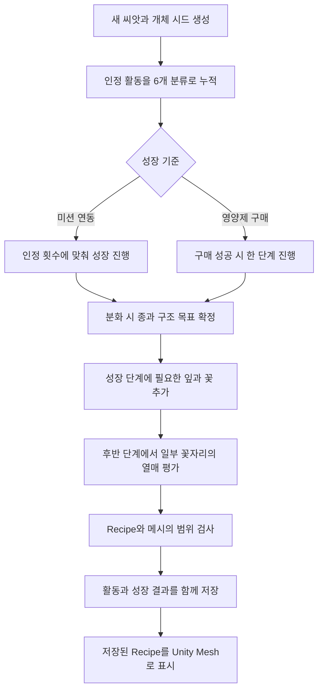

# 식물 생성 알고리즘 설명서

공통 씨앗에서 시작해 활동 이력으로 12종 중 하나를 정하고, 같은 종에서도 줄기·잎·꽃·열매가 달라지는 현재 생성 과정을 설명한다. 핵심은 **활동 비율로 종류를 선택하고, 활동 비율과 개체별 고정 난수로 외형을 정한 뒤, 그 결과를 저장하여 성장에 따라 보여주는 것**이다.

기준일은 2026-10-13이며, 코드 기준은 커밋 `64642e6fa269f66047fe5e7ce114cbe26ce8b6e6`이다. 새 개체는 성장 규칙 `GeneratorVersion=2`, 기하 표현 `MeshVersion=2`, 종 정의 `CatalogVersion=1`, 활동 프로필 `ProfileVersion=1`을 사용한다.

현재 생성기는 **실제 정원 화면과 영양제 성장 미리보기에도 연결되어 있다.** `LocalGardenState`에 외형 설계도를 함께 저장하며 기존 보상·구매 규칙을 유지한다. 성장 기준과 프로그램 목표를 선택하는 화면은 현재 개발용 미리보기 창에 있다. 본문의 기본 공식은 공통 생성기와 독립 성장 서비스 기준이며, 실제 앱의 성장값 변환과 호환용 프로필은 11절에서 구분한다. 설치·실행 방법은 [모듈 사용 안내](PROCEDURAL_PLANTS.md)를 참고한다.

## 1 전체 생성 흐름

식물의 외형을 담는 저장 데이터 `PlantRecipe`를 먼저 만들고, 이를 실제 3D 메시로 변환한다. Recipe는 식물의 설계도에 해당하며, Mesh는 그 설계도를 현재 성장 단계에서 화면에 나타낸 결과다.



종 확정은 분화 단계에서 한 번만 일어난다. 이후에는 기존 설계값을 유지하면서 새 기관을 추가하거나 표시 크기를 키운다. 여기서 **기관**은 줄기·잎·꽃·열매처럼 생성기가 관리하는 구성 단위다. 미션 연동에서는 인정 활동 완료가 성장 처리의 계기가 되지만, 구매 모드에서는 활동 집계와 성장 구매가 별도 사건이다.

현재 생성기는 **종별 형태 템플릿과 수치 파라미터를 조합하는 절차적 생성기**다. 문자열 치환을 반복하는 일반적인 L-system이나 실제 생육을 계산하는 물리 시뮬레이션은 구현하지 않는다.

## 2 입력과 활동 집계

### 6개 활동 분류

| 인덱스 | 약어 | 코드 값 | 의미 |
|---|---|---|---|
| 0 | BR | `Breath` | 호흡 |
| 1 | BD | `Body` | 몸 감각 |
| 2 | MV | `Movement` | 움직임 |
| 3 | SN | `Senses` | 감각 |
| 4 | RF | `Reflection` | 생각·감정 알아차림 |
| 5 | SC | `SelfCare` | 자기친절·돌봄 |

독립 성장 서비스에서는 미션을 호출하는 쪽에서 대표 분류 하나를 전달한다. 실제 앱에서는 `GardenPlantVisuals.TryCategory`가 알려진 미션 ID를 명시적 표에 따라 분류한다. 생성기는 미션 이름이나 일기 내용을 분석해 분류하지 않는다. 기분, 심박수, HRV, 연속 출석 기록은 생성 입력에 포함하지 않는다.

`PlantGrowthService.CompleteActivity`의 외형 집계 조건은 다음과 같다.

- 명시적으로 완료한 활동이며, 날짜 구분값 `CycleId`, 미션 ID와 분류가 유효해야 한다.
- 육성 중인 활성 식물에만 외형 크레딧을 부여한다. 완성한 식물의 외형은 바꾸지 않는다.
- 같은 `(CycleId, MissionId)`는 모든 식물에 걸쳐 한 번만 집계한다.
- 한 `CycleId`에서 최대 3회까지 집계한다. `CycleId`는 호출자가 전달하는 날짜이며, 생성기가 자체적으로 자정이나 시간대를 계산하지 않는다.
- 보상 자격이 없는 복습도 외형 집계 조건을 충족하면 반영된다.

**외형 크레딧과 영양제 보상은 구분된다.** 이 독립 서비스는 보상 자격이 있는 새 완료에 영양제 5개를 지급하며, 외형 집계 상한에 도달했더라도 보상 조건은 별도로 처리한다. 따라서 API의 성공 반환만으로 새 외형 크레딧이나 성장이 발생했다고 판단하면 안 된다. 중복 완료나 일일 상한 이후 완료도 처리 자체는 성공할 수 있다.

### 활동 횟수를 비율로 바꾸기

`c[k]`는 생성기에 전달하는 분류별 카운트, `N`은 그 합이다. 독립 서비스에서는 인정 활동 횟수이고, 실제 앱에서는 11절의 호환용 기본 프로필도 더해진다.

```text
N = Σ c[k]
p[k] = (c[k] + 1) / (N + 6)
```

각 분류에 1을 더해, 이력이 적을 때 한 분류가 과도하게 지배하는 것을 완화한다. 카운트가 모두 0이면 여섯 비율이 모두 `1/6`이다. 횟수가 늘수록 실제 활동 구성 비율에 가까워진다. 활동 구성 비율이 같아도 누적 횟수가 다르면 이 보정 때문에 `p`가 조금 달라질 수 있다.

아래는 **합성 활동 카운트**의 예다.

```text
분류 순서: BR, BD, MV, SN, RF, SC
c = [48, 3, 3, 3, 3, 20]
N = 80
p ≈ [0.569767, 0.046512, 0.046512, 0.046512, 0.046512, 0.244186]
```

관련 구현: [PlantGrowthService.cs](../Assets/Scripts/ProceduralPlants/PlantGrowthService.cs)의 `CompleteActivity`, [PlantMath.cs](../Assets/Scripts/ProceduralPlants/PlantMath.cs)의 `Profile`.

## 3 식물 종류 결정

### 종별 목표 활동 비율

각 종은 주 활동에 `0.60`, 보조 활동에 `0.25`, 나머지 네 활동에 각각 `0.0375`를 배정한 목표 벡터 `q[s]`를 갖는다. 이 대응은 외형 분화를 위한 게임 규칙이다.

| 종 | 주 활동 | 보조 활동 | 주요 형태 |
|---|---|---|---|
| 캐모마일 | BR 호흡 | SC 자기돌봄 | 가는 방사형 꽃잎, 갈라진 잎 |
| 데이지 | SN 감각 | BD 몸 감각 | 낮은 로제트 잎, 방사형 꽃 |
| 해바라기 | MV 움직임 | SC 자기돌봄 | 큰 꽃 중심, 심장형 잎 |
| 코스모스 | MV 움직임 | SN 감각 | 넓은 8장 꽃잎, 갈라진 잎 |
| 흰 캄파눌라 | SC 자기돌봄 | RF 생각·감정 | 흰 종 모양 꽃 |
| 물망초 | RF 생각·감정 | SN 감각 | 푸른 5갈래 작은 꽃 군집 |
| 프리지아 | SC 자기돌봄 | MV 움직임 | 검 모양 잎, 한쪽으로 이어지는 꽃 |
| 라벤더 | BR 호흡 | BD 몸 감각 | 가는 잎, 세로로 쌓인 꽃이삭 |
| 수국 | RF 생각·감정 | SC 자기돌봄 | 넓은 잎, 반구형 꽃 군집 |
| 분홍 장미 | SC 자기돌봄 | BD 몸 감각 | 5장 홑꽃, 복엽, 선택적 로즈힙 |
| 스노드롭 | BD 몸 감각 | BR 호흡 | 아래를 향한 바깥 3장·안쪽 3장 꽃 |
| 은방울꽃 | BD 몸 감각 | SN 감각 | 넓은 밑동 잎, 작은 종꽃, 선택적 열매 |

각 종의 목표와 실제 프로필 사이의 제곱 거리를 계산한다.

```text
distance[s] = Σ (p[k] - q[s,k])²
선택 종 = distance가 가장 작은 종
```

앞의 합성 카운트는 캐모마일 목표에 가장 가깝고, 캐모마일과의 제곱 거리는 약 `0.00127265`다. 거리 값은 종의 우열이나 사용자의 상태 점수가 아니다.

최솟값과의 차이가 `1e-12` 이하이면 동률 후보로 취급한다. 이때 종마다 `U(BaseSeed, "species-tie", SpeciesId)`를 계산해 가장 작은 값을 선택하고, 해시 값도 같으면 종 ID의 ordinal 문자열 순서로 결정한다. 동률이 아니면 개체 ID 난수는 종 선택에 관여하지 않는다.

### 종류를 확정하는 시점

목표 성장 횟수를 `M`, 현재 성장 단계를 `j`라고 하면 분화 단계는 다음과 같다.

```text
분화 단계 = ceil(M / 3)
```

분화 시에는 인정 활동 합계가 최소 6회여야 한다. 그 전에는 활동 변화로 후보 순위가 달라질 수 있다. 분화가 일어나면 `SpeciesId`와 당시 비율 `LockedProfile`을 저장하고 이후 종을 바꾸지 않는다.

| 목표 M | 분화 단계 | 비고 |
|---:|---:|---|
| 12 | 4 | 인정 활동 6회 조건을 별도로 충족해야 함 |
| 28 | 10 | 28일이 아니라 성장 28회 목표 |
| 48 | 16 | 주 6회·8주 프로그램의 횟수 예시 |
| 56 | 19 | 나눗셈 결과를 올림 |

관련 구현: [PlantCatalog.cs](../Assets/Scripts/ProceduralPlants/PlantCatalog.cs), [PlantGenerator.cs](../Assets/Scripts/ProceduralPlants/PlantGenerator.cs)의 `Candidates`, `LockSpecies`.

## 4 같은 종에서 외형이 달라지는 원리

### 개체 시드와 고정 난수

새 개체의 기본 시드는 사용자 참조 ID와 개체 ID를 이용해 만든다.

```text
BaseSeed = SHA256(Encode("GardenPlant", "1", ownerId, instanceId))
U(seed, node, tag) = UInt32BE(SHA256(Encode(seed, node, tag))[0:4]) / 2³²
```

`Encode`는 각 필드를 UTF-8로 바꾸고, 앞에 4바이트 big-endian 길이를 붙여 이어 붙인다. `BaseSeed`는 소문자 16진 문자열로 저장한다. 시드 식의 문자열 `"1"`은 현재 성장 규칙 버전 2와 별도로 유지하는 고정 값이다.

`U`는 0 이상 1 미만이며, 같은 입력이면 같은 값이 나온다. 예를 들어 `leaf/2`의 `length`와 `head/0`의 `size`는 서로 다른 키를 사용한다. 순서대로 소비하는 전역 난수 대신 기관·형질별 키로 난수를 구하므로, 새 기관을 추가해도 기존 기관의 난수 값이 밀리지 않는다.

공통 씨앗과 분화 전 새싹의 외형에는 이 난수를 적용하지 않는다. 같은 성장 설정·단계·메시 버전에서는 사용자나 활동 이력이 달라도 같은 초기 모습으로 보인다.

### 활동 비율과 난수의 결합

각 형질은 두 활동 `A`, `B`의 비율 차이와 고정 난수를 결합한다.

```text
z(A,B,node,tag) = clip(0.5 + 0.6 × (p[A] - p[B]) + 0.2 × (2U - 1))
clip(x) = min(1, max(0, x))
```

`0.5`를 중심값으로 두고 활동 비율 차이를 반영한 뒤, 난수에 따른 약 `-0.2~+0.2`의 변이를 더한다. 결과를 해당 종의 허용 범위로 변환한다.

```text
연속값 V(min,max,z) = min + (max - min) × z
정수값 I(min,max,z) = min(max, min + floor((max - min + 1) × z))
```

예를 들어 높이는 `MV-BR` 대비를 사용한다. 앞의 합성 카운트에서 **설명을 위해 해당 난수 U를 0.75로 가정**하면 `z≈0.286047`이다. 캐모마일의 높이 범위 `0.60~0.85`에 넣으면 목표 높이는 약 `0.671512`가 된다. 이 U는 특정 ID의 실제 해시 출력이라고 가정한 값이 아니다.

따라서 같은 종·같은 활동 이력에서도 개체 시드가 다르면 여러 형질이 달라질 수 있다. 다만 모든 개체 쌍이 눈으로 구분될 정도로 다르거나 외형이 절대 중복되지 않는 것을 보장하지는 않는다.

### 18개 제어 요소와 확정 시점

아래의 `z`는 각 항목에 지정된 고유 `node/tag`를 사용한다. 같은 활동 대비를 쓰더라도 같은 난수를 공유한다는 뜻은 아니다.

| 번호 | 요소 | 현재 결정 방식 | 확정 시점 |
|---:|---|---|---|
| 1 | 종 | 종별 목표와의 제곱 거리 최소 | 분화 |
| 2 | 높이 H | 종별 범위에 `z(MV,BR)` 적용 | 분화 |
| 3 | 줄기 반지름 r | `max(0.006, H × (0.012 + 0.012z(BD,RF)))` | 분화 |
| 4 | 줄기 굽힘 κ | `0.12 × (2z(BR,MV) - 1)` | 분화 |
| 5 | 구조 축 수 B | 종별 정수 범위에 `z(MV,BR)` 적용 | 분화 |
| 6 | 가지 벌어짐 θ | `15 + 30z(MV,BR)`도, 밑동형은 별도 상한 | 분화 |
| 7 | 잎 단위 수 L | 종별 정수 범위에 `z(BD,RF)` 적용 | 분화 |
| 8 | 잎 길이 ℓ | `H × V(종별 길이 비율, z(BD,MV))` | 각 잎 생성 |
| 9 | 잎 너비 비율 ρ | 종별 범위에 `z(BD,SN)` 적용 | 각 잎 생성 |
| 10 | 잎 가장자리 e | 종별 최대 강도 × `z(RF,SN)` | 각 잎 생성 |
| 11 | 잎 배열과 회전 | 종별 배열 + 개체별 시작 각도 + 작은 각도 편차 | 시작 각도는 분화, 개별 배치는 잎 생성 |
| 12 | 꽃 단위 수 C | 종별 정수 범위에 `z(SC,BR)` 적용 | 분화 |
| 13 | 단위당 작은 꽃 수 F | 종별 정수 범위에 `z(SN,RF)` 적용 | 각 꽃 단위 생성 |
| 14 | 꽃잎·갈래 수 P | 종별 정수 범위에 `z(SN,BD)` 적용 | 각 꽃 단위 생성 |
| 15 | 꽃 크기 D | `H × V(종별 크기 비율, z(SC,MV))` | 각 꽃 단위 생성 |
| 16 | 꽃 색 | 종별 두 색을 `z(SN,RF)`로 보간 | 각 꽃 단위 생성 |
| 17 | 열매 유무와 수 | 지원 종의 꽃자리별 고정 난수 평가 | 후반 성장 |
| 18 | 열매 반지름 | 종별 기준 반지름 × `(0.8 + 0.4z(SC,MV))` | 열매 평가 |

분화 시에는 당시의 `LockedProfile`로 구조 목표를 정한다. 이후 새 잎·꽃·열매에는 **각 생성·평가 시점의 최신 활동 프로필**을 사용한다. 기존 기관의 목표값과 부착점은 다시 추첨하지 않는다. 최종 활동 합계가 같아도 언제 어떤 활동을 하고 언제 성장했는지가 다르면 최종 모습이 달라질 수 있는 이유다.

개수는 렌더링 단위다. `B`는 주 줄기를 포함한 축 수, `L`은 고정 떡잎 2장을 포함한 잎 단위 수다. 장미의 복엽 하나나 캐모마일의 갈라진 잎 하나 안에 작은 잎 메시가 여러 개 들어갈 수 있다. `C`는 꽃머리·꽃송이·꽃이삭 등의 단위이며, `F`는 그 안의 작은 꽃 수다. 열매는 새로운 자리를 만드는 대신 기존 `(Head, Floret)` 자리를 사용한다.

관련 구현: [PlantMath.cs](../Assets/Scripts/ProceduralPlants/PlantMath.cs)의 `Hash`, `U`, `Z`, [PlantGenerator.cs](../Assets/Scripts/ProceduralPlants/PlantGenerator.cs)의 `LockSpecies`, `AddLeaf`, `AddHead`, `EvaluateFruit`.

## 5 독립 서비스의 성장 기준과 목표 횟수

개체를 만들 때 `GrowthMode`와 `MaxGrowthSteps`를 저장한다. 목표 `M`은 6~1000회이며, 정규화한 성장률은 `g=j/M`이다. 목표와 모드를 바꾸려면 미리보기에서 새 씨앗을 만든다. 현재 서비스에는 이미 자라는 개체의 목표를 변경하는 API가 없다.

| 모드 | 성장 조건 | 영양제 처리 |
|---|---|---|
| `NutrientPurchases` | `Grow` 구매 성공 때 한 단계 진행 | 10개 차감 |
| `MissionCompletions` | 새 외형 크레딧을 받을 때 누적 인정 횟수에 맞춰 진행 | 성장 비용 없음, 완료 보상은 별도 |

API 기본 인자는 12회 구매 모드이고, 미리보기 기본값은 28회 미션 모드다. 미리보기에는 12/28/48/56회 프리셋과 직접 입력이 있다. 목표 횟수는 달력 기간을 강제하지 않는다.

미션 모드의 목표 성장 단계는 다음과 같다.

```text
earned = min(M, N)
target = N < 6 ? min(earned, 분화 단계 - 1) : earned
현재 j가 target보다 작으면 Advance를 반복
```

짧은 목표에서는 분화에 필요한 인정 활동 6회 조건 때문에 잠시 성장을 보류한다. 예를 들어 `M=6`이면 분화 단계는 2지만, 인정 횟수 1~5에서는 `j=1`까지만 진행한다. 여섯 번째 인정 완료 시 같은 저장 처리 안에서 2~6단계를 계산해 완성한다. 보류 중인 인정 횟수를 버리는 방식은 아니다.

구매 모드에서는 활동을 많이 해도 구매 전까지 `j`가 증가하지 않는다. 분화 구매에 필요한 인정 횟수가 부족하거나 영양제가 부족하면 성장과 차감을 실행하지 않는다. 미션 모드에서 구매 성장을 요청해도 차감 없이 거절한다.

## 6 줄기와 기관의 단계별 발달

### 성장 곡선

표시 크기와 기관 수는 smoothstep 곡선 `S`로 조절한다.

```text
t = clip((g - a) / (b - a))
S(g; a,b) = t² × (3 - 2t)
```

`a` 이전은 0, `b` 이후는 1이다. 시작과 끝에서 변화가 완만하다. 현재 구현은 성장 사건마다 메시를 다시 만들며, 프레임마다 이 곡선을 따라 애니메이션하는 기능과는 구분된다.

종 확정 이후, 목표 개수를 `B*`, `L*`, `C*`라고 하면 보이는 기관 수는 다음과 같다.

```text
B(g) = 1 + floor((B* - 1) × S(g; 1/3, 0.48))
L(g) = 2 + floor((L* - 2) × S(g; 0.25, 0.90))
C(g) = 1 + floor((C* - 1) × S(g; 1/3, 0.75))
```

분화 전에는 씨앗 또는 공통 줄기와 떡잎 2장만 표시한다. `Birth` 값은 해당 기관 수에 도달하는 곡선상의 시점으로, `PlantMath.Birth`가 smoothstep의 역값을 이분 탐색해 계산한다. 실제 추가는 정수 성장 단계에서 이루어지므로 여러 기관이 같은 단계에 추가될 수 있다.

### 개화 전 줄기 길이 성장 종료

주 줄기의 표시 비율은 `S(g;0.25,0.50)`이다. 추가 축은 자기 `Birth`부터 `0.50`까지 길이를 늘린다. 분화 시 첫 꽃 단위를 주 줄기의 끝 꽃 `Terminal`로 만들고, 성장 중에는 봉오리의 표시 위치가 현재 줄기 끝을 따라가도록 한다.

```text
끝 꽃의 현재 부착점 = AxisPoint(부모 축, 현재 표시 비율)
끝 꽃의 현재 위치 = 저장한 최종 Tip + (현재 부착점 - 저장한 최종 Anchor)
```

`g≥0.50`이면 모든 구조 축의 길이가 고정된다. 그 뒤에는 잎·꽃 추가, 개화, 굵기와 기관 크기 변화, 열매 표현이 이어진다. 줄기 굵기는 `S(g;0.25,0.80)`을 사용하므로 길이보다 늦게 발달을 끝낸다.

추가 꽃은 가능한 경우 아직 끝 꽃이 없는 축의 끝에 배치한다. **모든 곁가지에 반드시 꽃을 하나씩 만든다는 규칙은 아니다.** 주 줄기의 첫 끝 꽃은 보장하고, 모든 구조 축의 길이 성장을 제한하여 꽃 위로 주 줄기가 계속 연장되는 상황을 막는다.

### 잎 크기와 꽃 열림

각 잎의 표시 길이는 저장한 목표 길이, 배치 보정값 `Scale`, 발달 비율의 곱이다.

```text
잎 길이(g) = Length × Scale × (0.2 + 0.8 × S(g; Birth, min(1, Birth+0.10)))
잎 너비(g) = 잎 길이(g) × Aspect
```

꽃 단위 인덱스 `i`는 0부터 시작한다. 뒤에 추가되는 꽃일수록 늦게 열린다.

```text
start[i] = 0.50 + 0.25 × i / max(1, C* - 1)
open[i] = S(g; start[i], start[i]+0.15)
꽃 크기(g) = Diameter × Scale × (0.25 + 0.75 × open[i])
```

`open<0.02`이면 초록색 봉오리로 그린다. 그 이후에는 종별 꽃 템플릿을 사용하고, 방사형 꽃은 꽃잎 방향을 위쪽에서 바깥쪽으로 펼친다. 한 꽃 단위 안의 작은 꽃 수도 `Birth`부터 최대 0.15 성장률 구간에 걸쳐 늘어난다.

### 목표 28회의 예

다음은 분화 전 인정 활동 6회 조건을 충족한 개체의 일정이다.

| 성장 단계 | 변화 |
|---:|---|
| 0 | 공통 씨앗 |
| 1~9 | 공통 새싹 |
| 10 | 종과 구조 목표 확정, 첫 봉오리 생성 |
| 14 | 성장률 50%, 구조 축의 길이 성장 종료 |
| 19 | 첫 꽃의 열림 비율이 1에 도달 |
| 21 | 목표 꽃 단위 수에 도달 |
| 24 | 성장률 5/6 이상, 조건을 충족한 꽃자리의 열매 평가 가능 |
| 26 | 목표 잎 수와 모든 꽃 단위의 열림 완료 |
| 28 | `Mature=true`, 추가 성장 종료 |

성장률 `5/6`은 열매 평가가 시작되는 기준이다. 개체의 **완성 상태는 반드시 `j=M`일 때**다. 또한 열매로 바뀐 자리는 더 이상 열린 꽃으로 그리지 않는다.

## 7 기관 배치와 공간 제약

주 줄기는 높이 방향의 축에 `t²`에 비례하는 수평 굽힘을 더한다. 곁가지는 부모 부착점, 길이, 벌어짐 각도, 방위각으로 만든다. 로제트·밑동 잎 식물과 라벤더는 밑동에서 올라오는 축 배치를 사용한다.

잎은 종별로 나선형, 마주남, 로제트, 밑동 배열을 사용한다. 나선형의 기본 회전은 약 `137.507764°`이며, 개체별 시작 각도와 잎별 작은 편차를 더한다. 새 잎은 현재 보이는 부모 축의 지지 가능한 부분에 붙인다.

기본 공간 한도는 식재 중심에서 **수평 반경 0.60, 최대 높이 1.30**이다. 이는 정원 로컬 좌표 단위이며 실제 미터를 뜻하지 않는다. 바닥에는 수치 오차를 고려해 `Y≥-0.001`을 허용한다.

배치가 한도를 벗어나면 새 기관에 대해 다음 순서로 조정한다.

| 기관 | 배치 조정 |
|---|---|
| 잎 | 방위각 0/+15/-15/+30도 후보 → 종별 최소 길이에 해당하는 축소 → 같은 부착점에서 안쪽·위쪽 방향 |
| 꽃 | 방위각 후보 → 종별 최소 크기에 해당하는 축소 → 최대 12개의 예약 위치 후보 |

꽃은 실제 봉오리·성숙 꽃 템플릿과 최대 열매 구체의 정점으로 경계를 추정하고, 기존 꽃과의 외접 구 중심 간격을 검사한다. 이미 저장한 기관을 옮겨 자리를 만드는 방식은 사용하지 않는다. 마지막에는 현재 단계의 전체 메시 정점이 한도 안에 있는지도 검사한다.

이 검사는 공간 한도와 큰 군집의 과도한 겹침을 줄이기 위한 것이다. 모든 꽃잎·잎 사이의 삼각형 충돌을 검사하지 않으므로 자연스러운 겹침이나 일부 교차는 남을 수 있다. 유효한 배치를 만들 수 없으면 해당 성장 처리를 실패시키고 저장·차감을 진행하지 않는다.

## 8 꽃에서 열매로 바뀌는 과정

현재 열매를 표현하는 종은 분홍 장미와 은방울꽃이다. 다음 조건을 모두 충족하는 꽃자리를 순서대로 평가한다.

1. 성장률이 `5/6` 이상이다.
2. 해당 꽃 단위가 완전히 열렸다.
3. 그 작은 꽃이 현재 보이는 자리이며, 이전 평가 기록이 없다.
4. 첫 꽃자리인 `Head=0, Floret=0`이 아니다.
5. 해당 종의 평가 자리 수 상한이 남아 있다.

```text
열매 확률 π = 0.25 + 0.50 × z(SC,RF,해당 꽃자리,"propensity")
Present = U(BaseSeed,해당 꽃자리,"present") < π
```

확률 계산과 유무 추첨은 서로 다른 태그를 사용한다. 이때의 프로필은 **열매를 평가하는 성장 단계의 최신 활동 비율**이다. 결과는 `Present=true/false` 모두 저장하여 이후에 다시 추첨하지 않는다.

장미의 상한은 3, 은방울꽃의 상한은 5다. 코드가 상한과 비교하는 값은 성공한 열매 수가 아니라 **실패까지 포함한 `Fruits` 평가 기록 수**다. 따라서 장미에서 3개 자리를 평가해 1개만 성공했다면, 다른 자리를 계속 평가해서 열매 3개를 채우지 않는다.

목표 반지름은 장미 `0.035`, 은방울꽃 `0.018`을 기준으로 `0.8~1.2`배 범위에서 정한다. 평가 단계 `e` 이후 표시 크기를 키우고, 최종 완성 단계에서는 목표 반지름을 전부 사용한다.

```text
미완성 상태의 반지름 = 목표 반지름 × (0.2 + 0.8 × clip((j-e+1)/(M×0.25)))
완성 상태의 반지름 = 목표 반지름
```

성공한 자리는 꽃 대신 열매를 그린다. 첫 꽃자리는 평가 대상에서 제외되므로 최소 한 꽃자리는 보존된다.

## 9 Refined 다각형 메시 생성

`PlantGeometry.Build`는 Recipe를 정점·법선·색 목록으로 변환한다. 종별 형태를 만드는 템플릿을 현재 길이와 크기로 배치하고, `ProceduralPlantView.Render`가 이를 Unity의 단일 Mesh에 넣는다.

### 기본 도형

| 도형 | 용도 | 현재 구성 |
|---|---|---|
| Tube | 줄기, 가지, 잎자루, 꽃자루 | 주로 6각 단면의 테이퍼 관, 용도별로 4각·5각도 사용 |
| Orb | 씨앗, 봉오리, 꽃 중심, 열매 | 소수의 둘레 분할과 위도 고리를 사용한 다면체 |
| SolidBlade | 잎 조각, 꽃잎 | 8점 외곽과 앞·뒤 중심을 연결한 닫힌 형태, 조각당 16개 삼각형 |
| SolidCup | 종꽃, 나팔꽃 | 4단 외곽 고리, 안쪽 벽, 입구와 밑면의 테두리 |

Refined의 아트 기준은 [PrototypeGardenArt.cs](../Assets/Editor/Prototype/PrototypeGardenArt.cs)의 `Batch.Blade`와 `Assets/Art/Prototype/RefinedMeshes/Chamomile_Refined_*`다. 최종 렌더링은 삼각형을 사용하지만, 외곽과 앞뒷면을 구성해 두께 있는 다각형처럼 보이도록 한다.

잎은 솟은 중심을, 꽃잎은 끝쪽이 넓고 가장자리가 살짝 내려가는 외곽을 사용한다. 두께는 길이와 너비에 비례하므로 작은 새 잎이나 가는 소엽이 과도하게 부풀지 않는다. 한 잎 단위가 여러 `SolidBlade` 조각으로 이루어질 수 있으므로, 잎 단위 전체가 항상 16개 삼각형인 것은 아니다.

### 종별 형태 조합

- 캐모마일은 방사형 꽃잎, 10각 둘레의 노란 중심, 7개의 작은 꽃가루 돌출부를 조합한다. 갈라진 잎은 중심 잎자루에 4쌍의 작은 잎 조각을 붙인다.
- 장미의 복엽은 2쌍의 작은 잎과 끝 잎을 조합한다. 해바라기의 심장형 잎은 기본 잎에 좌우 밑동 부분을 더한다.
- 수국과 물망초는 작은 꽃들을 황금각에 가까운 간격으로 반구에 분산한다. 라벤더는 작은 꽃을 회전시키며 위로 쌓는다.
- 프리지아 등 여러 꽃을 가진 단위는 작은 꽃을 한쪽으로 이어 배치한다. 스노드롭은 긴 바깥 꽃잎 3장과 짧은 안쪽 꽃잎 3장을 사용한다.

꽃 색은 종별 두 팔레트 색을 **Linear RGB**에서 보간한다. 작은 꽃별 밝기 편차와 메시 면별 명암을 더해 입체감을 낸다. 현재 전용 셰이더는 URP 환경광·주광원·추가 광원과 그림자를 사용한다. 정원의 낮·밤과 가로등에 반응하고 HDR 후처리에도 참여한다. 식물 자체는 발광하지 않는다.

식물 하나는 Mesh 하나와 전용 Material 하나를 소유한다. 삼각형마다 정점과 법선을 분리하여 면의 경계가 드러나며, 한 메시의 상한은 8,000개 삼각형이다. 메시 교체 때 이전 메시를 해제하고, 개체 제거 때 메시와 재질을 해제한다. 유휴 상태에서 매 프레임 생성하거나 전역 난수를 새로 뽑지 않는다. 여러 식물 사이의 공유 메시 캐시는 아직 없다.

관련 구현: [PlantGeometry.cs](../Assets/Scripts/ProceduralPlants/PlantGeometry.cs), [ProceduralPlantView.cs](../Assets/Scripts/ProceduralPlants/ProceduralPlantView.cs), [PlantVertexColor.shader](../Assets/Resources/ProceduralPlants/PlantVertexColor.shader).

## 10 저장과 재현성

### 저장하는 설계 정보

| 데이터 | 주요 내용 |
|---|---|
| PlantRecipe | 개체 ID, BaseSeed, 버전, 성장 기준·목표·단계, 활동 횟수, 종, 분화 당시 프로필, 구조 목표 |
| AxisRecipe | 부모 축, 부착점, 길이, 방위각, 벌어짐, 생성 기준 시점 |
| LeafRecipe | 부모, 앵커, 방향, 목표 길이·너비 비율·가장자리, Scale |
| HeadRecipe | 부모, 끝 꽃 여부, Anchor·Tip, 작은 꽃 수, 꽃잎 수, 크기, 색, Scale |
| FruitRecipe | 원래 꽃자리, 평가 단계, 성공 여부, 목표 반지름 |
| PlantGardenState | 전체 식물, 활성 식물 ID, 영양제, 활동·보상·요청 영수증 |

처음부터 모든 미래 기관을 완성해 저장하지는 않는다. 분화 시 구조 목표와 축 설계를 만들고, 잎·꽃·열매의 Recipe는 해당 성장 단계에서 추가한다. 한편 렌더링용 정점 전체를 저장하지는 않는다. 저장된 Recipe와 지원하는 버전의 템플릿으로 메시를 다시 만든다.

### 저장 성공 후에만 결과 반영

```text
요청 ID와 기존 처리 결과 확인
→ 현재 상태를 깊은 복사
→ 활동 집계 또는 성장 계산
→ 새 기관과 열매 평가 기록 추가
→ 상태 및 필요 시 메시 검증
→ 보상·차감·성장·영수증을 포함한 전체 상태 저장
→ 저장 성공 시 현재 상태 교체
→ 호출자가 저장된 Recipe를 렌더링
```

`Advance`는 입력 Recipe를 수정하지 않고 복사본을 반환한다. 서비스는 복사본에 변경을 계산하고 저장에 성공한 뒤에만 현재 상태를 교체한다. 저장 실패 시 원래 영양제·성장·종·기관·평가 결과가 유지된다. 같은 요청 ID와 같은 내용의 재전송은 이전 성공으로 처리하고, 다른 내용에 같은 ID를 사용하면 거절한다.

독립 시연용 `PlantXmlStore`는 전체 상태를 임시 XML에 쓰고 디스크 반영을 요청한 뒤 파일 교체·이동으로 저장한다. 실제 앱은 이 별도 저장소나 지갑을 만들지 않는다. 기존 `GardenState`의 선택적 `PlantAppearance`에 Recipe와 외형 크레딧을 넣고, 기존 미션 완료·성장 구매의 저장 트랜잭션 안에서 함께 반영한다.

### 버전 호환

| 버전 필드 | 구분하는 내용 | 현재 새 개체 |
|---|---|---:|
| GeneratorVersion | 성장 일정과 줄기·꽃 배치 규칙 | 2 |
| MeshVersion | 평면 중심 표현과 Refined 입체 표현 | 2 |
| CatalogVersion | 종별 범위와 형태 정의 | 1 |
| ProfileVersion | 활동 프로필 계산 규칙 | 1 |

이전 XML에 새 필드가 없으면 초기값을 사용한다. 성장 목표는 12회, 모드는 구매 방식, 메시 버전은 1로 복원한다. v1 성장 경로와 기존 v2의 메시 버전 1 경로를 유지하므로 기존 저장 식물을 자동으로 새 메시로 바꾸지 않는다. 알 수 없는 버전은 오류로 처리한다.

같은 Recipe의 재현성은 **동일한 지원 버전의 규칙·카탈로그·템플릿을 사용하는 조건**에서 성립한다. 앞으로 기존 카탈로그나 템플릿을 직접 바꾸기보다 새 버전을 추가하고 이전 경로를 유지해야 한다. 서로 다른 실행 환경의 GPU 픽셀까지 완전히 같다는 의미는 아니다.

## 11 개발용 설정과 실제 정원 연결

Unity의 `Tools > Mindful Garden > Procedural Plant Preview`는 활동 카운트, 종별 합성 예시, 개체 ID, 성장 기준과 목표를 직접 조절할 수 있다. 종별 예시는 특정 종에 가까운 활동 카운트를 넣으며, 종 ID를 강제로 지정하는 우회 기능은 아니다.

개발용 미리보기의 성장 버튼은 `PlantGenerator.Advance`를 직접 호출한다. **실제 활동 완료 영수증, 하루 3회 집계, 영양제 차감까지 실행하는 버튼은 아니다.** 독립 서비스와 실제 앱은 다음처럼 역할이 다르다.

| 사용 위치 | 성장·저장 방식 |
|---|---|
| 개발용 `Procedural Plant Preview` | 입력한 합성 카운트와 목표로 생성기를 직접 진행; 앱 저장과 분리 |
| 독립 `PlantGrowthService` | 본문의 구매·미션 연동 모드, 목표 6~1000회, 자체 시연용 트랜잭션 |
| 실제 정원 | 기존 보상·영양제 구매 유지; `GardenPlantVisuals`가 기존 성장값을 Recipe 단계로 변환; 기존 정원 상태에 함께 저장 |

### 실제 앱의 성장값 변환

실제 정원의 Recipe는 `M=12`, 구매 모드로 만든다. 그러나 앱에서 새로 12번 구매하도록 요구하는 것은 아니다. 기존 누적 성장값을 다음처럼 변환하여 기존 씨앗→새싹→봉오리→개화 흐름을 보존한다.

| 기존 누적 성장값의 대표값 | 화면 단계 | 생성기 단계 `j` |
|---|---|---|
| 0 | 씨앗 | 0 |
| 0.1 | 새싹 | 3 |
| 0.2 | 봉오리 | 4 |
| 0.3 이상 | 개화 | 12 |

코드의 구간 경계는 부동소수점 오차 여유를 둔 `0.099`, `0.199`, `0.299`다. 누적 성장값은 기존 `LegacyGrowth`와 `plant:P06`의 성장값 합계다. 목표 단계까지 `Advance`를 반복하므로 중간 단계의 기관 생성·평가도 수행한다. 개화 후 구매에는 기존의 제한된 표시 크기 증가를 유지한다. 개발용 28·48·56회 프로그램을 실제 앱의 새 구매·보상 정책으로 적용하지는 않았다.

### 기존 저장과 활동 이력의 연결

첫 연결 시 기존 설치 ID와 고정 개체 ID `garden-main`으로 시드를 만들고, 선택적 외형 필드를 추가한다. 기존 지갑·구매 영수증·미션 기록은 유지한다. 호환용 기본 프로필 `[4,0,0,0,0,2]`를 별도 `BaselineProfileCounts`로 저장하며, Recipe의 카운트는 **이 기본 프로필 + 인정된 실제 활동 크레딧**이다. 이는 실제 완료 6회를 뜻하지 않으며 보상이나 완료 영수증을 만들지 않는다. 알려진 이력이 없는 기존 개화 식물은 이 기본 프로필에 따라 캐모마일을 유지하고, 기존 성장 흐름에서 새로운 활동 수 제한으로 막히지 않는다.

실제 활동은 보상이 확정된 세션 중 알려진 미션 ID만 인정한다. 완료 시각과 세션 ID 순으로 처리하며, 같은 일일 주기·미션 조합은 한 번, 주기별 최대 3개를 외형에 반영한다. 모르는 미션 ID나 자유 입력 문장에서는 분류를 추측하지 않는다. 이미 성숙한 Recipe에는 추가 활동을 반영하지 않으며, 분화한 종과 생성한 기관의 목표값도 다시 추첨하지 않는다.

`GardenHomePresenter`는 저장 Recipe를 `ProceduralPlantView`로 표시한다. 영양제 구매 미리보기는 분리된 상태 복사본에서 성장시킨다. 취소하면 원래 외형으로 돌아가며, 저장에 실패하면 기존 Recipe와 영양제를 유지한다. 자세한 연결 범위는 [실제 정원 연결 문서](PROCEDURAL_GARDEN_INTEGRATION.md)에 기록되어 있다. 성장 tween과 다중 개체 메시 캐시는 아직 구현하지 않았다.

## 12 구현 위치와 검증 근거

| 파일 | 읽을 핵심 내용 |
|---|---|
| [PlantCatalog.cs](../Assets/Scripts/ProceduralPlants/PlantCatalog.cs) | 12종의 목표 분류, 높이·개수·기관 크기 범위, 형태, 팔레트 |
| [PlantMath.cs](../Assets/Scripts/ProceduralPlants/PlantMath.cs) | 비율, 해시 난수, 형질값, 보간, 성장 곡선 |
| [PlantRecipe.cs](../Assets/Scripts/ProceduralPlants/PlantRecipe.cs) | 설계 데이터, 버전 기본값, XML 직렬화 |
| [PlantGenerator.cs](../Assets/Scripts/ProceduralPlants/PlantGenerator.cs) | 분화, 구조 확정, 기관 추가, 배치, 열매 평가, 검증 |
| [PlantGrowthService.cs](../Assets/Scripts/ProceduralPlants/PlantGrowthService.cs) | 집계 자격, 성장 모드, 보상·차감, 중복 요청, 원자적 저장 |
| [GardenPlantAppearance.cs](../Assets/Scripts/Runtime/GardenPlantAppearance.cs) | 실제 앱의 미션 분류, 호환용 프로필, 성장값 변환, 외형 동기화 |
| [LocalGardenState.cs](../Assets/Scripts/Runtime/LocalGardenState.cs) | 기존 정원 저장과 외형의 트랜잭션, 이전 저장 읽기 |
| [GardenHomePresenter.cs](../Assets/Scripts/Runtime/GardenHomePresenter.cs) | 홈 화면의 저장 Recipe 표시 |
| [PlantGeometry.cs](../Assets/Scripts/ProceduralPlants/PlantGeometry.cs) | 현재 성장 단계의 실제 정점·법선·색 생성 |
| [ProceduralPlantView.cs](../Assets/Scripts/ProceduralPlants/ProceduralPlantView.cs) | Unity Mesh 적용과 리소스 수명 |
| [ProceduralPlantPreview.cs](../Assets/Editor/ProceduralPlants/ProceduralPlantPreview.cs) | 개발용 설정과 합성 성장 미리보기 |
| [PlantContractChecks.cs](../Assets/Tests/ProceduralPlants/Editor/PlantContractChecks.cs) | 종 도달, 저장 복원, 성장 일정, 범위·예산, 중복·실패 처리 검사 |

[검증 기록](PROCEDURAL_PLANTS_VALIDATION.md)의 2026-10-12 항목에 따르면 생성기·기하·상태 처리의 56,253개 검증 항목과 Unity 테스트 3개가 통과했다. 해당 표본의 최대 메시 크기는 4,684개 삼각형이었다. 이 숫자는 모든 가능한 개체의 최댓값이나 모바일 실측 성능이 아니며, 생성 시에는 별도로 8,000개 한도를 검사한다.

같은 기록의 2026-10-13 항목에는 정원 상태·관련 회귀 1,344개 assertion, Unity EditMode 4/4, 통합 UI 검사 32/32, 실제 Play 모드 저장·복원, 12종 낮·밤 렌더링, Android IL2CPP 빌드와 합성 정원을 이용한 기기 확인 통과가 남아 있다. 이는 해당 구현 작업의 검증 기록을 인용한 것이며, 이 설명서 작성 과정에서 전부 다시 실행한 결과는 아니다.

핵심 계약은 초기 모습의 공통성, 분화 후 종 고정, 기존 기관 목표값 보존, 열매 재추첨 방지, 같은 저장본의 외형 복원, 저장 실패 시 자원·성장 불변이다. 이 계약을 유지하면서 종별 카탈로그, 성장 일정, 메시 표현을 각각 조정할 수 있도록 역할을 분리했다.
